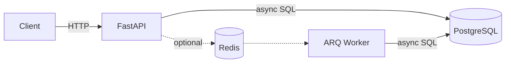
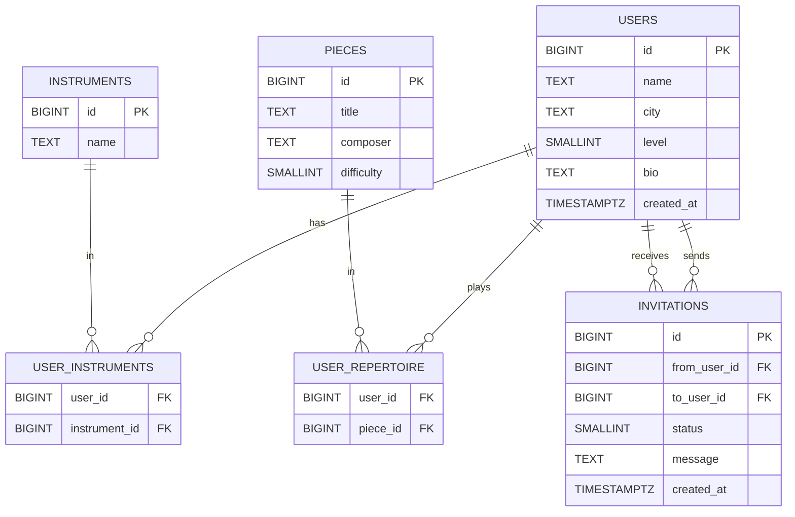

# ensemble-finder
Backend service for matching musicians by instrument, skill level, and shared repertoire. FastAPI + PostgreSQL + Docker.


# 🎻 Ensemble Finder

Сервис для поиска партнёров по совместной игре на музыкальных инструментах.

## 🎯 Зачем

У музыканта круг партнёров по ансамблю почти всегда ограничен средой, в которой он учится или работает: консерватория, школа, оркестр, круг друзей. Найти человека **вне этого пузыря** — со схожим уровнем, подходящим инструментом и общим репертуаром — сложно и почти негде.

Ensemble Finder решает эту задачу, подбирая партнёров по трём характеристикам:

- 🎼 **инструмент** — важно, чтобы тембры сочетались (скрипка + фортепиано ≠ скрипка + скрипка);
- 📈 **уровень** — разрыв в 2+ балла делает совместную игру некомфортной для обоих;
- 📚 **общий репертуар** — то, что реально можно сыграть вместе уже на первой встрече.

## 🏗️ Архитектура

### Общая схема


Приложение построено как классический **backend-only сервис с асинхронным API**. Клиент общается с FastAPI по HTTP, вся работа с БД — через async-драйвер `asyncpg`. Опциональный Redis + воркер добавлены для асинхронной обработки уведомлений о заявках.

### Компоненты

- **API** — HTTP-слой, валидация через Pydantic.
- **Services** — матчинг, изолирован от HTTP и ORM.
- **PostgreSQL** — источник правды, async-драйвер `asyncpg`.
- **Redis + ARQ** — опционально, для фоновых уведомлений о заявках.

### Модель данных



## 🚀 Запуск

### 1. Инфраструктура

```bash
docker compose up -d
docker compose ps
```

Поднимает `postgres:16-alpine` на `5432` и `redis:7-alpine` на `6379`.

### 2. Зависимости

```bash
uv sync
```

### 3. Миграции

```bash
uv run alembic upgrade head
```

### 4. Seed-данные

```bash
uv run python -m scripts.seed
```

Заполняет БД: 10 инструментов, 20 пьес, 5 пользователей с репертуарами и инструментами. Идемпотентен — повторный запуск полностью пересоздаёт данные.

### 5. Приложение

```bash
uv run uvicorn app.main:app --reload
```

Swagger UI: http://localhost:8000/docs


## 🌐 API

| Метод | Путь | Назначение |
|---|---|---|
| `GET` | `/health` | Healthcheck |
| `POST` | `/api/v1/users/` | Создать пользователя |
| `GET` | `/api/v1/users/{user_id}` | Получить пользователя |
| `POST` | `/api/v1/match/` | Найти партнёров для пользователя |

### Пример

```bash
curl -X POST http://localhost:8000/api/v1/match/ \
  -H "Content-Type: application/json" \
  -d '{"user_id": 4, "top_k": 5}'
```

Ответ:

```json
{
  "target_user_id": 4,
  "results": [
    {
      "user_id": 5,
      "score": 0.7272,
      "common_pieces": [1, 8],
      "breakdown": {
        "repertoire": 0.5,
        "level": 1.0,
        "city": 1.0,
        "instruments": 0.5,
        "total": 0.7272
      }
    }
  ]
}
```

Поле `breakdown` возвращается наружу сознательно: пользователь видит, **за счёт чего** сложился score, а не просто «магическое число».

## 🧮 Формула матчинга

```
score = w_repertoire  · jaccard(pieces_a, pieces_b)
      + w_level       · (1 - |level_a - level_b| / 3)
      + w_city        · [city_a == city_b]
      + w_instruments · (1 - jaccard(instruments_a, instruments_b))
```

Веса нормируются на сумму в рантайме (`_normalize_weights`), поэтому score всегда лежит в `[0, 1]` без клампинга. Дефолты `0.5 / 0.3 / 0.2 / 0.1` → `0.4545 / 0.2727 / 0.1818 / 0.0909`.

Особенности метрик:

- **Уровни** — `1..4`, делим на 3, чтобы максимальная разница давала 0.
- **Инструменты** — гладкая метрика `1 - jaccard`: полное совпадение → 0 бонуса, отсутствие пересечений → максимум. Оба пусты → 0 (нет данных ≠ идеальное несовпадение).
- **Город** — `None` не равен `None`: два пользователя без города не получают бонус за совпадение.

### Ключевые решения

- **Матчинг — чистая функция без ORM.** Тестируется без БД, формулу легко заменить.
- **Прозрачная формула вместо ML.** Возвращаем `breakdown` и `common_pieces` — пользователь видит, **за счёт чего** сложился score, а не просто число.
- **Веса в конфиге.** Крутить можно без деплоя.

## 🧪 Тестирование

```bash
uv run pytest -v
```

### Что покрыто

`tests/test_matching.py` — 20+ юнит-тестов на ядро матчинга:

- `jaccard` — частичное, полное, пустое пересечение, оба пустых;
- `_level_similarity` — совпадение, максимальный разрыв, симметрия;
- `_city_match` — совпадение, различие, `None`;
- `_instrument_compatibility` — идентичные, дизъюнктные, частичные, оба пустых;
- `_normalize_weights` — сумма в 1.0, дефолтные веса, zero-weights → `ValueError`;
- `calculate_match_score` — smoke-кейсы `0.9091` и `0.697`, кастомные веса, симметрия, breakdown;
- `rank_candidates` — сортировка по убыванию, `top_k`, исключение себя, пустой pool.

### Что не покрыто и почему

- **Интеграционные тесты API** (`/users`, `/match` с реальной БД) — осознанный компромисс. Приоритет отдан юнит-тестам на матчинг: это ядро, в нём вся математика и вся сложность. Интеграционные тесты требуют отдельной тестовой БД, `conftest.py` с фикстурами и транзакционных откатов — это следующий шаг, вне MVP.
- **Seed-скрипт** — dev-инструмент, тестировать нечего.
- 
### Что осознанно за скоупом MVP

- **Аудиоанализ и парсинг MIDI** — не влияет на матчинг по репертуару.
- **WebSocket-чат** — отдельный слой, в roadmap.
- **ML-рекомендации** — нет достаточно данных, прозрачные веса дают лучший UX на старте.

## 📄 Лицензия

MIT — см. [LICENSE](./LICENSE).
